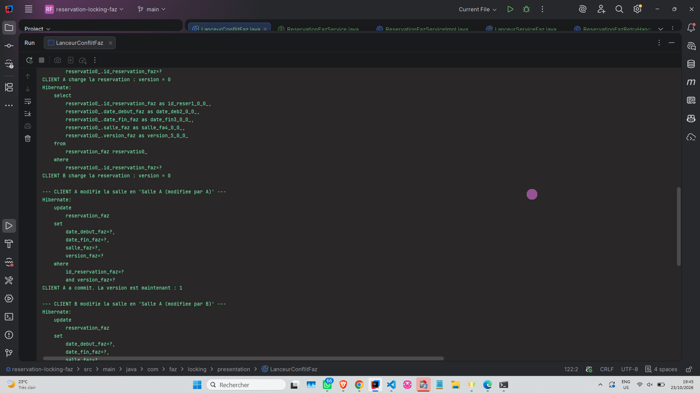
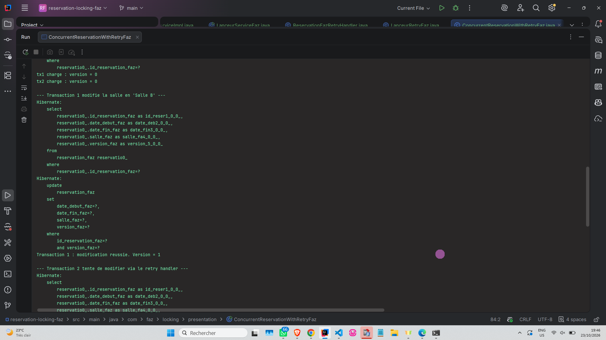
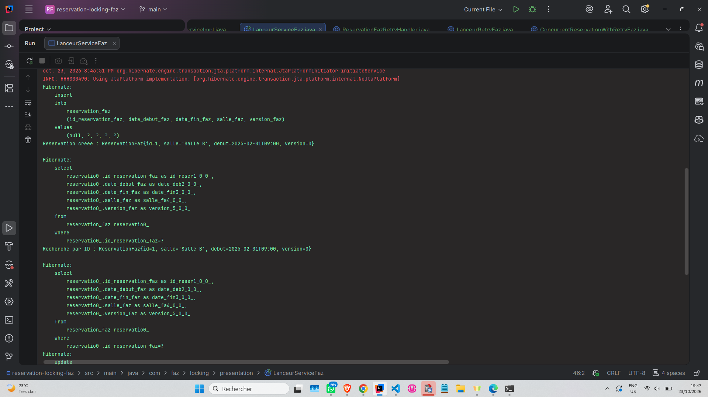

# Reservation Locking - Verrouillage Optimiste JPA (Faz)

Projet Java JPA/Hibernate démontrant le verrouillage optimiste avec `@Version` pour gérer la concurrence dans une application de réservation.

## 🎯 Fonctionnalités

- Entité `ReservationFaz` avec `@Version`
- Service CRUD `ReservationFazService`
- Simulation de conflit concurrent avec 2 `EntityManager`
- Gestion de l'`OptimisticLockException`
- Stratégie de retry automatique

## 📸 Captures d'écran

### 1. Service CRUD (Lanceur1)
*Création, recherche, modification et liste des réservations.*

---

### 2. Conflit concurrent détecté (Lanceur2)
*Le client B tente de modifier une réservation déjà modifiée par le client A → `OptimisticLockException`.*

---

### 3. Stratégie de retry (Lanceur3)
*Le retry handler recharge la version à jour et réussit la modification.*

